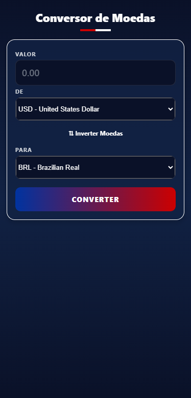
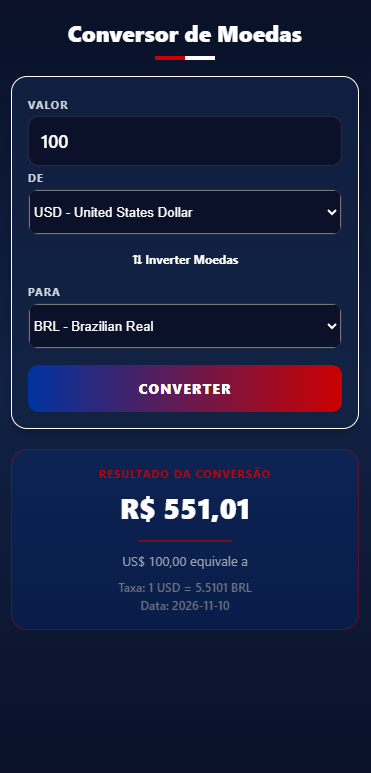

# 💱 Conversor de Moedas

Aplicativo mobile desenvolvido com **React Native e JavaScript**, utilizando a arquitetura **MVVM (Model-View-ViewModel)** e a API pública Frankfurter para realizar conversões entre diferentes moedas.

O aplicativo permite informar um valor, selecionar a moeda de origem e destino e visualizar o resultado da conversão com base nas taxas de câmbio disponibilizadas pela API.

## 🎯 Objetivo

Desenvolver um aplicativo mobile para praticar conceitos de React Native, consumo de APIs REST, gerenciamento de estados e organização de código utilizando a arquitetura MVVM.

## 🚀 Funcionalidades

- Consulta automática das moedas disponíveis na API.
- Seleção da moeda de origem e destino.
- Conversão entre diferentes moedas.
- Exibição do valor convertido.
- Apresentação da taxa de câmbio utilizada.
- Exibição da data de referência da taxa.
- Botão para inverter as moedas.
- Validação dos valores informados.
- Tratamento de erros de conexão e consulta.
- Indicadores de carregamento.

## 🛠️ Tecnologias utilizadas

- React Native
- JavaScript
- Expo Snack
- React Hooks (`useState`, `useEffect`, `useCallback`)
- Fetch API
- Frankfurter API
- React Native Picker
- Expo Linear Gradient

## 🏗️ Estrutura do projeto

O projeto segue a arquitetura MVVM, separando a interface visual, as regras de negócio e o acesso aos dados.

```text
ConversorMoedas/
│
├── App.js
│
├── src/
│   ├── views/
│   │   └── ConverterScreen.js
│   │
│   ├── viewmodels/
│   │   └── useCurrencyConverter.js
│   │
│   └── models/
│       └── currencyModel.js
│
└── components/
    └── AssetExample.js
```

### Model

Responsável pela comunicação com a API Frankfurter, realizando as consultas das moedas disponíveis e das taxas de câmbio.

### View

Responsável pela interface do aplicativo, apresentando os campos de entrada, seletores de moedas, botões e resultados.

### ViewModel

Responsável pelo gerenciamento dos estados, validação dos valores, coordenação das consultas e processamento dos resultados.

## 🌐 API utilizada

O projeto utiliza a API pública [Frankfurter](https://frankfurter.dev/) para consultar as moedas e as taxas de câmbio.

**Listagem de moedas:**

```text
https://api.frankfurter.dev/v2/currencies
```

**Consulta de taxa de câmbio:**

```text
https://api.frankfurter.dev/v2/rate/USD/BRL
```

Os códigos das moedas são definidos conforme as opções selecionadas pelo usuário.

> **Importante:** As taxas fornecidas pela Frankfurter são taxas de referência e não representam necessariamente cotações comerciais em tempo real.

## ▶️ Como executar o projeto

O desenvolvimento foi realizado utilizando o Expo Snack.

1. Acesse o [Expo Snack](https://snack.expo.dev/).
2. Abra ou importe o projeto.
3. Organize os arquivos conforme a estrutura apresentada neste README.
4. Verifique se as dependências abaixo estão disponíveis:

   - `expo-linear-gradient`
   - `@react-native-picker/picker`

5. Execute o aplicativo pelo Expo Snack.
6. Utilize a visualização do ambiente ou abra o projeto em um dispositivo compatível com Expo Go.

Não é necessária uma chave de autenticação para utilizar os endpoints públicos da Frankfurter empregados neste projeto.

## ✅ Validações

O aplicativo realiza algumas verificações antes de executar uma conversão:

- O campo de valor não pode estar vazio.
- O valor deve ser numérico e maior que zero.
- Valores decimais são aceitos com ponto ou vírgula.
- As moedas de origem e destino devem estar selecionadas.
- Não é permitido selecionar a mesma moeda para origem e destino.

## 🧪 Testes

Os principais cenários previstos para testar o funcionamento são:

- Carregamento inicial da lista de moedas.
- Conversão entre moedas diferentes.
- Entrada de valores decimais.
- Tentativa de conversão com campo vazio.
- Entrada de valores negativos ou iguais a zero.
- Entrada de valores inválidos.
- Seleção de moedas iguais.
- Falha de conexão com a API.
- Atualização do resultado após uma nova conversão.
- Exibição da taxa e da data de referência.

## 📚 Aprendizados

Durante o desenvolvimento, são trabalhados conceitos como:

- Organização de projetos com arquitetura MVVM.
- Separação de responsabilidades.
- Desenvolvimento de interfaces com React Native.
- Consumo de APIs REST.
- Manipulação de dados JSON.
- Gerenciamento de estados com React Hooks.
- Validação de informações.
- Tratamento de erros em requisições assíncronas.

## 👨‍💻 Projeto acadêmico

Projeto desenvolvido com finalidade educacional, como atividade prática de desenvolvimento mobile utilizando React Native, JavaScript, Expo e arquitetura MVVM.


## 📱 Capturas de Tela

<div align="center">
  
  
</div>